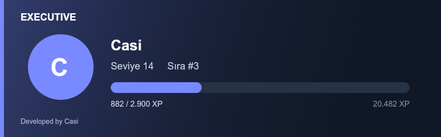

# Ultimate Executive — Community Edition

**Developed by Casi**

Kendi bilgisayarınızda veya sunucunuzda çalışan, Türkçe varsayılanlı ve İngilizce destekli Discord topluluk botu. Ana komut öneki **`.`**. Tek SQLite veritabanı kullanır; ücretli API, web paneli, alan adı, Redis veya harici veritabanı gerekmez.

> Bu geliştirme sürümü kapsamlı biçimde test edilmedi. 184 otomatik test, gerçek SQLite ve taklit Discord istemcileriyle geçti. Canlı Discord sunucusunda uçtan uca test, Docker çalıştırma ve üretim yükü doğrulaması henüz yapılmadı. [Test kapsamı](PROJECT_STATUS.md)

## Başlangıç

1. Node.js **24 LTS** kurun ve `npm install -g pnpm@10.10.0` çalıştırın.
2. Bu klasörde `pnpm install` çalıştırın.
3. `.env.example` dosyasını `.env` adıyla kopyalayın. `DISCORD_TOKEN`, `APPLICATION_ID`, `BOT_OWNER_ID` alanlarını kendi uygulamanıza göre doldurun. Token'ı paylaşmayın.
4. Discord Developer Portal → Bot bölümünde **Message Content Intent** ve **Server Members Intent** açın. Ses etkinliği için Guild Voice States intent'i kodda zaten etkin.
5. Botu `bot` ve `applications.commands` kapsamlarıyla test sunucunuza ekleyin. Gereken izinleri [kurulum kılavuzundan](docs/INSTALL_TR.md) seçin. Yönetilecek üye/roller bot rolünün altında olmalı.
6. `pnpm register` ile `/executive` komutunu kaydedin. `.env` içindeki `DEV_GUILD_ID` doluysa yalnız o sunucuya kaydeder.
7. `pnpm build`, ardından `pnpm start`.
8. Sunucu sahibi `.panel` veya `/executive panel` açabilir. `.help` komutları listeler. `.staff` personele Discord'un tehlikeli yerel izinlerini dağıtmadan bot komutları atar.

```text
.staff grant role ROL_ID warn mute sil
.staff group moderator kick mute sil warn
.staff assign role ROL_ID moderator
.language en
.dil tr
.config module economy off
.daily
.quiz teknoloji
.xox @üye
.ticket setup DESTEK_ROL_ID - KAYIT_KANAL_ID off
.ticket panel
```

`pnpm dev` geliştirme için doğrudan TypeScript çalıştırır. `.env` ve `data/` Git dışında tutulur.

## Modüller

| Modül | Bağlı özellikler |
|---|---|
| Moderasyon | Ban/unban, kick, yerel timeout, silme, uyarılar, karantina, kilit, slowmode, nick, rol rengi, vaka geçmişi ve personel sayımları |
| Personel | Kullanıcı/rol/komut/grup yetkileri, korumalı kullanıcı/roller, işlem sınırları, devredilen sunucu ayar yönetimi |
| Oyunlar | TKM, XOX, Connect Four, quiz, kelime, adam asmaca, düello, sayı, emoji, yazı tura, zar, 8ball |
| Ekonomi | Sunucuya özel sanal cüzdan, günlük/haftalık/iş ödülleri, atomik transfer, mağaza, envanter, güvenli rol/rozet/eşya ödülleri |
| Seviye | Mesaj/ses XP, spam koruması, PNG rank kartı, sıralama ve güvenli seviye rolleri |
| Sosyal | Profil, bio, itibar, onaylı sanal evlilik/boşanma, AFK, kalıcı hatırlatma ve doğum günleri |
| Topluluk | Kalıcı çekiliş/yeniden çekiliş, anket, etkinlik/RSVP, özel destek kanalları, isteğe bağlı sınırlı döküm |
| Araçlar | Karşılama/ayrılma, güvenli otomatik/self roller, öneriler, embed, metin tabanlı özel komutlar/yanıtlar, duyurular, sabit mesajlar, bilgiler ve istatistikler |
| Kontrol paneli | Kalıcı düğme/seçici/modal yönlendirme, sunucuya özel dil, modül ve temel ayarlar |



Sunucu sahibi veya yetkili yapılandırma yöneticisi `.dil tr`, `.language en` veya `/executive language` ile Türkçe ve İngilizce arasında geçiş yapabilir. Seçim sunucuya özel kaydedilir. Slash komutlarını yenilemek için `pnpm register` çalıştırın.

Modül kapatıldığında komutları, etkileşimleri, olay işleyicileri ve zamanlanmış işleri çalışmaz; veriler silinmez. Geçmiş süreli işler modül açılınca işlenir. `.config` ve `.panel` kurtarma için kapatılamaz.

## Belgeler

- [Türkçe kurulum](docs/INSTALL_TR.md) · [English installation](docs/INSTALL_EN.md)
- [Registry'den üretilen eksiksiz komut listesi](docs/COMMANDS.md)
- [Yapılandırma ve panel](docs/CONFIGURATION.md)
- [Ekonomi, seviye ve sosyal sistemler / Systems guide](docs/SYSTEMS.md)
- [Ultimate Guard entegrasyonu](docs/GUARD.md)
- [Mimari, veri ve işletim](docs/ARCHITECTURE.md)
- [Doğrulama ve açık işler](PROJECT_STATUS.md)
- [Katkı](CONTRIBUTING.md) · [Güvenlik](SECURITY.md) · [MIT lisansı](LICENSE)

## English quick start

Install Node.js 24 LTS and pnpm 10.10.0. Run `pnpm install`, copy `.env.example` to `.env`, supply your own Discord application credentials, enable the Message Content and Server Members intents, and invite the bot with the permissions described in [INSTALL_EN.md](docs/INSTALL_EN.md). Run `pnpm register`, `pnpm build`, and `pnpm start`. Use `.panel` or `/executive panel` as the guild owner. Choose English with `.language en` or `/executive language locale:English`.

The primary prefix is `.`. `/executive run command:<name> arguments:<arguments>` invokes the same registry and business logic. This self-hosted development release has a local SQLite database, durable jobs, Turkish and English messages, and no required paid services.

> This release has not been comprehensively tested. All 184 automated tests passed with SQLite and mocked Discord clients. Live Discord end-to-end tests, Docker runtime checks, and production load testing remain pending. [Test coverage](PROJECT_STATUS.md)

## Kontroller

```text
pnpm typecheck
pnpm lint
pnpm test
pnpm build
pnpm commands
```

GitHub Actions, Windows ve Ubuntu üzerinde aynı kontrolleri çalıştıracak şekilde hazırlanmıştır. İş akışı uzakta henüz çalıştırılmamıştır.

Docker için `.env` hazırladıktan sonra `docker compose up -d --build` kullanın. Veriler `executive-data` biriminde saklanır. Aynı veritabanıyla birden fazla bot işlemi başlatmayın.
